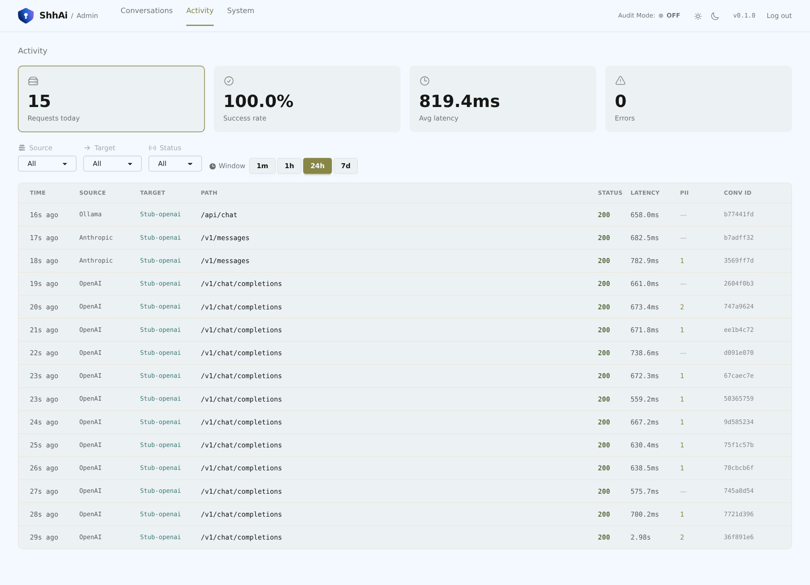

# ShhAi

**An LLM privacy proxy: it strips PII from provider traffic, then restores it.**

ShhAi sits between your coding harness (Claude Code, opencode, OpenWebUI, Cline,
Aider, Continue, Zed, …) and your LLM backends — hosted (OpenAI, Anthropic) or
local (Ollama). Your prompts are sanitised on the way out so names, emails,
keys and other PII never reach a provider, and the placeholders are restored in
the response so you still get a correct, readable answer.

Point a tool at ShhAi with **only a base-URL change**: no plugin, no per-harness
code. It speaks the OpenAI (`/v1/chat/completions`), Anthropic (`/v1/messages`)
and Ollama (`/api/*`) dialects.



## The problem it solves

You want a provider's models without handing over the data inside your prompts.
ShhAi is a transparent intermediary — it intercepts, sanitises, forwards, and
restores:

- **PII never leaves in the clear.** Message text, tool-call arguments, tool
  results, and streamed deltas all round-trip through one canonical pipeline
  (ADR [0003](docs/adr/0003-pii-pipeline-openai-canonical.md),
  [0007](docs/adr/0007-conversation-tracking.md),
  [0008](docs/adr/0008-pii-pipeline-restore-state.md)).
- **Routing is deterministic.** A request goes only to a backend that actually
  serves its model, and the backend is pinned to the conversation for its
  lifetime (ADR
  [0013](docs/adr/0013-provider-instance-pinning-and-model-aware-routing.md)).
- **The proxy is closed by default.** An inbound API-key gate rejects requests
  when no key is configured; only allowlisted headers reach the backend; logs
  and errors are redacted.
- **Nothing is retained unless you ask.** Audit Mode is opt-in, and the store is
  encrypted at rest. Off is the default — and a default deployment has no
  database at all (ADR
  [0010](docs/adr/0010-sqlite-audit-mode-datastore.md)).
- **Failures are honest.** A detector error fails closed (blocks) unless you
  explicitly opt into `PII_ERROR_MODE=forward`; provider errors pass through
  untouched; a distinct `503` means no capable backend is reachable.

## 60-second quickstart (Docker)

Requires Docker with Compose. From the repo root:

```sh
# 1. Configure: copy the template and fill in three values.
cp .env.example .env
```

Edit `.env` and set, at minimum:

| Variable | What to put |
|---|---|
| `SECRET_KEY_BASE` | A long random string — `openssl rand -base64 48` (or `mix phx.gen.secret`) |
| `PROXY_API_KEYS` | The bearer key your tools will present, e.g. `my-dev-key` |
| `PROVIDER_OPENAI_1_ENABLED` | `true`, with `PROVIDER_OPENAI_1_API_KEY=sk-...` |

Point `PROVIDER_*_BASE_URL` at your backend (the defaults hit OpenAI,
Anthropic, and a local Ollama). Set `ADMIN_PASSWORD` if you want the dashboard.

```sh
# 2. Build and run the full image (EXLA + baked NER model).
docker compose up --build
```

The proxy is now on <http://localhost:4000>. Send it a request — PII in the
prompt is replaced before it reaches the provider, then restored in the reply:

```sh
curl http://localhost:4000/v1/chat/completions \
  -H "Authorization: Bearer my-dev-key" \
  -H "Content-Type: application/json" \
  -d '{"model":"gpt-4o",
       "messages":[{"role":"user",
         "content":"My name is John Smith, email john@example.com. Say hi."}]}'
```

Orchestration probes are unauthenticated and exempt from TLS redirect:
`GET /health` (liveness) and `GET /ready` (readiness).

The admin dashboard is at <http://localhost:4000/admin> (login with
`ADMIN_USER` / `ADMIN_PASSWORD`). Without `ADMIN_PASSWORD` it refuses to serve
(`403`) — it is never world-readable.

**Slim image (regex-only, no ML stack).** Set `SHHAI_SLIM=true` in `.env` to
build the variant that drops `nx`/`exla`/`bumblebee` and boots with NER off:

```sh
docker build --build-arg SHHAI_SLIM=true -t shh-ai:0.1.0-slim .
```

## How it works

```
harness ──▶ ShhAi ──▶ provider
          sanitise      (PII replaced by <TYPE_N> placeholders)
harness ◀── ShhAi ◀── provider
          restore       (placeholders mapped back to originals)
```

1. The inbound gate authenticates the caller and strips anything not on the
   outbound header allowlist.
2. Every request is converted to the OpenAI **canonical format**, where PII
   detection and placeholder substitution happen once, regardless of the
   source or target dialect.
3. A backend is selected by which one serves the requested model, then pinned
   to the conversation. A transient connection failure retries once on another
   capable backend; provider HTTP errors are passed through unchanged.
4. The response (including streamed deltas and tool calls) is restored before
   it reaches the client.

## Configuration

ShhAi is configured entirely through environment variables — secrets are never
baked into the image. **[`.env.example`](.env.example)** is a commented template
covering every setting, and **[`docs/configuration.md`](docs/configuration.md)**
is the canonical reference, with `ShhAi.Config` as the source of truth.

Highlights: `PROXY_API_KEYS` (inbound gate), `PROVIDER_<TYPE>_<N>_*` (backends,
up to 4 each), `PII_*` (detection and fail policy), `AUDIT_*` (opt-in encrypted
store), `ADMIN_*` (dashboard), and `SECRET_KEY_BASE` (required in production).

## Documentation

The docs are hand-written Markdown in [`docs/`](docs/) — browsable on GitHub, no
generated site for 0.1.

| Document | What it covers |
|---|---|
| [docs/installation.md](docs/installation.md) | From-source and Docker installation |
| [docs/configuration.md](docs/configuration.md) | Every environment variable |
| [docs/integrations.md](docs/integrations.md) | Pointing each harness at ShhAi |
| [docs/privacy.md](docs/privacy.md) | What is and isn't protected, in plain language |
| [docs/threat-model.md](docs/threat-model.md) | Trust boundary, fail policies, 0.1 limitations |
| [docs/benchmarks.md](docs/benchmarks.md) | Detection accuracy and latency |
| [docs/testing.md](docs/testing.md) | Test suites and how to run them |
| [docs/architecture/](docs/architecture/) | Design notes for the streaming/pipeline seams |
| [docs/adr/](docs/adr/) | Numbered architecture decision records |

## Project

- [CHANGELOG.md](CHANGELOG.md) — release history (Keep a Changelog).
- [CONTRIBUTING.md](CONTRIBUTING.md) — dev setup, test loop, and PR flow.
- [SECURITY.md](SECURITY.md) — how to report a vulnerability.
- [LICENSE](LICENSE) — Apache-2.0.
